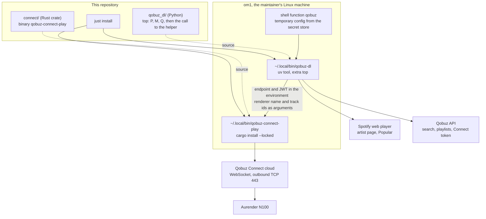

# Plan: `top`, an artist's popular tracks played from Qobuz

Status: proposed on 18 November 2026 for [issue #99](https://github.com/pascalandy/qobuz-dl/issues/99). Nothing here is implemented. Gate G1 did not pass on its first try that day and its prerequisites are not all checked, so the work is held at G1 and playback on the N100 is unproven; no other gate has run. The issue owns live status; this page owns the design.

## Goal

`qobuz-dl top "Dire Straits"` plays the band's best-known songs on the maintainer's Aurender N100 streamer, from Qobuz. The song list comes from the "Popular" section of the artist's Spotify page. No Spotify audio is fetched.

## Acceptance criteria

- One command creates the private playlist `Top · Dire Straits` in the Qobuz account
- The playlist holds the best studio version of each song, in Spotify's order
- A second run replaces the playlist and leaves no duplicate
- The tracks play on the N100 with no phone and no vendor app. Playback loads the tracks as a queue, not the playlist itself
- What was playing on the N100 stops, and the queue takes its place
- A song with no Qobuz match is skipped and reported

## Relationship to the project direction

This command is an exception to the fork's recorded direction, and it is stated here so that it is a decision and not drift.

- The [Qobuz API direction](../2026-05-26-qobuz-api-direction/vision-qobuz-api-direction.md) keeps the fork a conservative downloader. `top` downloads nothing: it writes a playlist to the account and controls a player
- [Dependencies](../../dependencies.md) keeps one runtime dependency, and `AGENTS.md` makes `qobuz_dl/http.py` the only network boundary. `top` adds SpotAPI, which brings its own HTTP stack
- The fork is Python only. `top` adds a Rust helper

The exception is bounded: SpotAPI is an optional extra imported only by `top`; the Rust crate stays out of the wheel; every Qobuz HTTP call still goes through `qobuz_dl/http.py`; default tests stay offline. A plain install of the fork gets none of it.

The command lives in this fork, and not in a new project, because it reuses the fork's app-id extraction and its HTTP boundary.

## Design

### Where it runs

One machine, om1: it is always on, it has a Rust toolchain, and it shares the N100's network. macOS is out of scope.

`just install` puts both executables in `~/.local/bin`: `qobuz-dl` through `uv tool install` from this checkout with the `top` extra, and `qobuz-connect-play` through `cargo install --locked --path connect --root "$HOME/.local"`, since Cargo's default root is `~/.cargo`. The recipe ends by checking that both commands resolve on the `PATH`. No package registry or app store carries either one. Without the helper, `top` still saves the playlist, then reports the missing helper and exits nonzero.

### Sign-in

The fork signs in with an email and a password digest (`qobuz_dl/qopy.py`, `_login_params`). Qobuz refuses that login for the maintainer's account: three attempts failed on 18 November 2026 at commit `7821354`, while the app id was accepted. The account's stored config is the one of upstream `vitiko98/qobuz-dl` at its pull request 331, which signs in with a `user_auth_token`.

`top` therefore reads `app_id` and `user_auth_token` from the selected config, sets the `X-User-Auth-Token` header, and never calls `user/login`. It needs no email, no password, and no file-signing secret, because it fetches no media. Gate G3 proves this path before anything else is built.

On om1 the config comes from the maintainer's encrypted secret store as a temporary `0600` file that the store removes when the command exits, through the `qobuz` shell function of his dotfiles, which gains a Linux branch. That branch passes the delivered path with `--config`, so the fork's default lookup cannot pick another file. No permanent config file is created on om1. The typed command is `qobuz top "Dire Straits"`.

### CLI frame

- `top` is dispatched before download state is opened: no history database, no output folder
- `--dry-run` with `top` is a usage error, exit `2`
- Exit is nonzero when nothing matched, when the artist is ambiguous, when the playlist could not be verified, or when playback could not be confirmed. In the last case the message says the playlist was saved

### P: the Popular list

SpotAPI reads the artist page without credentials: `Artist.query_artists` finds the artist id from the name, then `get_artist` reads the page. Spotify shows at most 10 tracks.

- `top` accepts an artist only when exactly one returned candidate has a name equal to the query, ignoring case and accents. With none or several, it lists the candidates and exits nonzero without writing
- `top` pins the web player's TOTP secret (version 61) and replaces SpotAPI's `get_latest_totp_secret`. Without that, SpotAPI falls back to its version 18 secret and asks the slow third-party host `code.thetadev.de`. Gate G8 records the SpotAPI version and the pin it proved

### M: matching to Qobuz

SpotAPI gives no ISRC, so `top` searches with `track/search` and compares title, artist, and duration.

1. A candidate matches when its main artist equals the Spotify artist and its title equals the Spotify title, both compared without case, accents, punctuation, or a trailing remaster or edition note (in brackets or after a dash, such as `- 2022 Remaster`), and its duration is within 3 seconds
2. If `track/search` carries no `release_type`, read it from `album/get` for the candidates that passed step 1
3. Keep studio recordings only, whatever Spotify's own title says: drop a candidate whose title or version field marks it as live, a demo, a remix, or a re-recording, and drop a candidate whose release is a live album or a compilation. A Popular entry that is itself a live recording therefore gets its studio version or is skipped
4. Drop versions the account cannot stream (`streamable`, and `hires_streamable` for hi-res)
5. Among the rest, prefer an album, then a single or EP, then an unknown release type, and within one release type keep the highest resolution (`maximum_bit_depth`, `maximum_sampling_rate`). The album-or-single order is a preference, not a filter: a hit released only as a single must still match

This is a new, track-level selection. `smart_discography_filter` (`qobuz_dl/utils.py`) filters albums by a regex on the title and does not read `release_type`.

### Q: writing the playlist

`qobuz_dl/http.py` gains a POST. Writes use `application/x-www-form-urlencoded`, while the client sets `application/json` for the whole session (`qobuz_dl/qopy.py`), so the write sets its own content type.

`top` recognises its own playlists by a marker in the description that names the artist, `qobuz-dl top · <Spotify artist id>`, never by name alone.

1. Create the private playlist (`playlist/create`, `is_public=false`) with the marker, then add the tracks (`playlist/addTracks`)
2. Read it back by its id and check the marker, that it is private, and that its track ids equal the matched ids in order
3. If the add or the check fails, delete the playlist just created, leave the earlier ones, and exit nonzero. If that deletion cannot be confirmed, the message gives the id of the playlist left behind
4. If the check passes, delete every other playlist that carries that artist's marker (`playlist/getUserPlaylists`, `playlist/delete`), then list again. If any other marked playlist remains, name it and exit nonzero, even when playback succeeds

With zero matches, `top` writes nothing. `playlist/deleteTracks` is avoided: the reference capture marks it unverified.

### C: starting playback

[`ciaens/qobuz-connect`](https://github.com/ciaens/qobuz-connect) (MIT) is a Rust library with no binary. It makes no HTTP call: it expects an endpoint and a JWT that the Qobuz API mints for a signed-in user.

- Python mints the endpoint and the JWT through `qobuz_dl/http.py`, just before the call, and passes them as `QOBUZ_CONNECT_ENDPOINT` and `QOBUZ_CONNECT_JWT` in the helper's environment, never as arguments. The renderer name and the track ids are arguments
- The helper makes the N100 the active renderer and waits until the session reports the N100's renderer id as active, because `SetPlayerState` addresses whichever renderer is active. It asks for the highest quality (`SetMaxAudioQuality`), then loads the tracks with `LoadTracks`, which replaces the queue
- It accepts only the queue event that echoes the action uuid `control` returned for its own load and that lists the same track ids in order. It then sends `SetPlayerState` to play the first acknowledged queue item, and succeeds only when the N100's renderer id reports that item playing. A playback report carries a bare queue item id, so a late report from the replaced queue could look the same; gate G6 establishes how the helper tells them apart, and the helper is not written before that. `control` only queues commands, so a clean return proves nothing
- It gives up after 30 seconds without the renderer, or without confirmed playback, and exits nonzero
- It exits once playback is confirmed. The N100 must then advance on its own; gate G6 checks that

The cloud path needs only outbound TCP 443. The official apps also hand a session to a device over the local network (mDNS and three HTTP calls); the library implements only the device side of that handover. Gates G5 and G5b establish whether the N100 needs it.

## Gates before the build

The build starts only after the gates pass, in order, on om1. A failed gate stops the work, and the issue records what was observed. No gate prints a secret.

| Gate | What must work | How | State on 18 November 2026 |
| --- | --- | --- | --- |
| G1 | The N100 is a Qobuz Connect renderer for this account | In Conductor: Settings, Streaming Services, External Control Services, Qobuz Connect, Enable Service ([Aurender](https://ask.aurender.com/hc/en-us/articles/45050487899671-Play-Qobuz-on-your-Aurender-with-Qobuz-Connect)). The maintainer then picks the N100 in the official Qobuz app and plays a track. He stops playback and closes every official Qobuz app, so that later gates do not ride on that session | Not passed, held here. On the first try the Qobuz app did not list the N100. An mDNS browse from om1 lists `_qobuz-connect._tcp` for two other streamers but not for the N100, which advertises `_aurender._tcp` and AirPlay. Conductor works. To check before the test is repeated: the service toggle, the N100's software version, the exact model (Aurender lists the N100, N100C, and N100SC, not the N100H), and whether the USB DAC was on, which Aurender requires for USB output |
| G2 | om1 reads the account from the secret store | Inside the store's `exec` wrapper, `sh -c 'test -s "${QOBUZ_CONFIG_INI:-}"'` | Open. om1 is a recipient of the store |
| G3 | The token signs in from om1 with no email or password | A throwaway script makes one authenticated read (`playlist/getUserPlaylists`, limit 1) with `app_id` and `user_auth_token`, validates the listing in memory, and prints only pass or fail | Open. It blocks everything else |
| G4 | The account can mint a Connect token | The same script makes the library's `TokenRequest` call and prints only that an endpoint and a JWT arrived | Open |
| G5 | Discovery: a third-party controller sees the N100, cold | After G1: official apps closed, then the N100 power-cycled, always. Once the N100 has booted, the library's `listen` example runs with the minted values in its environment. The probe waits at most 30 seconds for the server to confirm that its own session joined; a probe that does not join in that time is a failed probe, to run again, not a verdict on the account or the N100. From the confirmation it watches for 60 seconds. Pass: the N100 is listed within the window. Only a session that stayed joined for the whole window without listing the N100 sends the work to G5b. Discovery passes through G5 or through G5b; if neither passes, the path is unproven and the work stops | Open |
| G5b | Discovery by handover, only when G5 did not list the N100 | First, a mint check: a throwaway script must obtain in memory everything the handover carries (`src/discovery.rs` of the library): a Connect JWT for the renderer with its endpoint and expiry, and an API JWT with its expiry. The library's `TokenRequest` asks only for a Connect token (`jwt_qws`); where the API JWT comes from is not known today, and finding it is part of this gate. The session id is the one of the controller session that stays joined, read from that session, and the controller keeps its own JWT, because two sockets on one token evict each other. If the mint check fails, the gate fails without a verdict on the N100. Then the script reads the N100's Connect advertisement and sends it the three HTTP calls. Pass: the N100 appears in the controller's session within 60 seconds. A pass adds a story for the controller side of the handover, in which the helper keeps one session for the handover and for playback. A fail ends automatic playback on the N100 | Open. The N100 advertises no `_qobuz-connect._tcp` today, so this gate has nothing to call until G1 passes |
| G6 | A third-party controller starts playback, and playback continues alone | Every earlier probe is stopped first. Run 1, from a cold N100 with official apps closed: the minimal controller, preceded in the same run and on the same session by the handover of G5b when G5b was needed. Pass: track one is confirmed, the helper exits, and with no controller left the N100 advances to track two. Run 2, takeover: while the N100 plays an unrelated track, the same command replaces it, and a person checks on the N100 that the track playing is the first of the new queue. This run also records what the session reports during the switch, to settle how the helper ties a playback report to its own queue. Whether the N100 shows hi-res is recorded apart and does not decide the gate. Another Connect streamer in the house is an optional control when the N100 fails | Open. It changes what plays in the house: run only on the maintainer's word |
| G7 | The account can write and replace a playlist | Run the replacement of Q twice with a marker used only by this test and two tracks, in one order on the first run and reversed on the second, and record both playlist ids. Pass: after the second run the second id is the only playlist with that marker, it is private, it holds the two tracks in the reversed order, and the first id is gone. Then delete it | Open. It writes to the account: run only on the maintainer's word |
| G8 | Spotify answers without credentials from om1, and Qobuz search carries what M needs | SpotAPI `query_artists`, then `get_artist`, for Dire Straits with the pinned TOTP secret. Pass: an ordered, nonempty Popular list in which each entry has a title, an artist, and a duration. Then, after G3, one of those tracks goes through `track/search` and, if needed, `album/get`. Pass: the answers carry the title, artist, duration, version, streamable flags, resolution, and release type that M reads. The gate records the SpotAPI version | Open |

If G1 still fails once its prerequisites are checked, if G5b fails, or if G6 works on another streamer but not on the N100, automatic playback on the N100 is not possible through Qobuz Connect, and the maintainer decides what is left of the goal.

The library's `controller` and `token` examples are not used as proof. `controller` skips to the second track itself, pauses before it exits, and never asks for the highest quality. `token` prints a curl command with the account token in its arguments.

## Stories, in order, after the gates

1. Token sign-in for `top`, and the POST in `qobuz_dl/http.py`
2. P and M, with offline fixtures
3. Q
4. The `connect/` crate, `just install`, one Rust CI job on Ubuntu, and the call from Python
5. In the maintainer's dotfiles: the Linux branch of the `qobuz` function

Each story updates the documents it makes stale: [Dependencies](../../dependencies.md) for the optional extra, [Packaging](../../packaging.md) for the crate and `just install`, [Architecture](../../architecture.md) for the new command path, and the [CLI reference](../../cli.md).

## What the research established on 17 November 2026

- **Spotify's official API is closed for this use.** Since 11 February 2026, a new app in development mode has no access to an artist's top tracks or to editorial playlists ([migration guide](https://developer.spotify.com/documentation/web-api/tutorials/february-2026-migration-guide))
- **SpotAPI reads the Popular tracks without credentials.** The path depends on the web player and is fragile ([SpotAPI](https://spotapi.readthedocs.io/en/latest/reference/))
- **Qobuz's unofficial API can create a playlist.** Third-party clients document `POST playlist/create` and `POST playlist/addTracks` ([capture of April 2026](https://github.com/arthursoares/qobuz_tidal_api_client/blob/main/docs/api-spec.md))
- **An ISRC does not choose the edition.** It names the recording, and a compilation keeps the original's ISRC ([IFPI handbook](https://www.ifpi.org/wp-content/uploads/2021/02/ISRC_Handbook.pdf))
- **Aurender lists the N100, N100C, and N100SC as Qobuz Connect devices,** on "the latest software" and with no minimum version given; the N100H is not listed ([Aurender](https://ask.aurender.com/hc/en-us/articles/45050487899671-Play-Qobuz-on-your-Aurender-with-Qobuz-Connect), updated 15 November 2026). The N100 is not Roon Ready, and no Aurender API was found
- **Qobuz does not support third-party Connect controllers** ([Qobuz help](https://help.qobuz.com/en/articles/313603-can-qobuz-connect-be-used-via-a-third-party-app))

## Risks

- **Qobuz's terms** forbid reverse engineering ([Canadian terms](https://www.qobuz.com/ca-en/legal/terms)). The fork already uses the unofficial API. `top` adds account writes and a third-party controller to that exposure. [Qobuz access and project status](../../qobuz-access.md) owns the fork's access decision
- **Two unofficial protocols.** SpotAPI and Qobuz Connect can break without notice
- **Nobody is known to have driven an N100 with a third-party Connect controller.** The gates settle it

## Review record

The plan was reviewed in six rounds before this page: three on the first version (Fable 5.2, Sol 6.1, Fable 5.2), then three by Sol 6.2 on the versions that placed the helper and added the gates. Sol 6.2 raised 17 findings, all checked against source and accepted; it did not approve. A further review of this page by Sol 6.2 is recorded in [pull request #100](https://github.com/pascalandy/qobuz-dl/pull/100).
