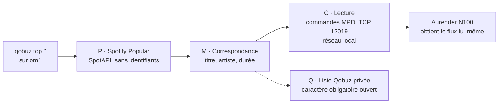

# TOP : dossier d'affaires

Document source du plan, écrit le 2026-11-19. Il consolide trois sources et les changements survenus depuis la fusion de la page de design. Après ce commit, il est en lecture seule : les titres de section servent d'ancres aux lignes `Traces` du plan.

Chaque fait porte une marque :

- **[D]** décidé par le PM
- **[P]** prouvé par une observation datée
- **[S]** supposé : écrit dans une source, pas encore observé
- **[O]** ouvert : aucune décision ni preuve

## 1. But

- [D] `qobuz-dl top "<artiste>"` fait jouer sur le Aurender N100 de Pascal les chansons les plus connues d'un artiste, depuis Qobuz
- [D] La liste des chansons vient de la section « Popular » de la page Spotify de l'artiste. Aucun flux audio de Spotify n'est obtenu
- [D] La lecture automatique fait partie du but, pas d'une phase ultérieure
- [D] La commande vit dans la fourche `pascalandy/qobuz-dl`, pour réutiliser l'extraction de l'`app_id` et la frontière HTTP `qobuz_dl/http.py`

## 2. Historique des sources

| Date | Source | Ce qu'elle apporte |
|---|---|---|
| 2026-11-17 | Issue #99, corps et plan v1 | La demande, les critères d'acceptation, la recherche initiale |
| 2026-11-18 | Issue #99, plans v2 et v3 | La machine om1, la voûte, la connexion par jeton, les portes G1 à G8 |
| 2026-11-18 | `docs/feat/2026-11-18-top-artist-playback/plan-top-artist-playback.md` (PR #100) | La page de design revue, en une page. Elle remplace les commentaires v1 à v3 pour la conception |
| 2026-11-19 | Issue #101, corps | L'échec de la porte G1, la décision sur Qobuz Connect, cinq pistes de remplacement (A à E) |
| 2026-11-19 | Issue #101, commentaire | Le résultat de l'enquête sur la piste B, en lecture seule |
| 2026-11-19 | Consignes du PM au planificateur | L'essai de lecture est une pièce du plan du projet, et le projet est mis en ordre avant de commencer |

Quand deux sources se contredisent, la plus récente l'emporte. La page de design reste la référence pour les sections 5, 6, 7, 9 et 10 de ce document. Sa section « C: starting playback » et ses portes G1, G4, G5, G5b et G6 ne s'appliquent plus.

## 3. Critères d'acceptation d'origine

Tirés de l'issue #99 et de la page de design. Les marques disent ce qui tient encore.

1. [D] Une seule commande crée la liste privée `Top · <Artiste>` dans le compte Qobuz. [O] Son caractère obligatoire est remis en question : voir la section 14
2. [D] La sélection contient la meilleure version studio de chaque chanson, dans l'ordre de Spotify
3. [D] Relancer la commande remplace la liste Qobuz sans laisser de doublon
4. [D] Les pistes jouent seules sur le N100, sans téléphone ni app du fabricant. La lecture charge les pistes comme file d'attente, pas la liste elle-même
5. [D] Ce qui jouait sur le N100 s'arrête et la sélection prend sa place. [O] Remplacer la file ou y ajouter : voir la section 14
6. [D] Une chanson sans correspondance sur Qobuz est sautée et signalée

## 4. Parcours cible

- [D] Les étapes P, M et Q de la page de design ne changent pas
- [D] L'étape C par Qobuz Connect sort du plan (section 13)
- [S] L'étape C devient quelques commandes MPD envoyées en Python sur le réseau local (section 8)
- [S] L'étape C n'a plus besoin de l'étape Q : elle ajoute les pistes une par une, avec les identifiants que M fournit

## 5. Connexion Qobuz

- [P] La fourche se connecte par courriel et empreinte du mot de passe (`qobuz_dl/qopy.py`, `_login_params`). Qobuz refuse cette connexion pour le compte de Pascal : trois essais ratés le 2026-11-18, au commit `7821354`, alors que l'`app_id` était accepté
- [P] La config du compte dans la voûte (`QOBUZ_CONFIG_INI`) est celle de l'amont `vitiko98/qobuz-dl` à sa PR 331, qui se connecte par `user_auth_token`. Elle marche sur le MacBook Pro
- [D] `top` lit `app_id` et `user_auth_token` dans la config choisie, pose l'en-tête `X-User-Auth-Token` et n'appelle jamais `user/login`
- [D] `top` n'a besoin ni de courriel, ni de mot de passe, ni du secret de signature des fichiers, parce qu'il n'obtient aucun média
- [S] Le jeton connecte depuis om1 (ancienne porte G3). Essai prévu : une lecture authentifiée (`playlist/getUserPlaylists`, limite 1), validée en mémoire, qui n'imprime que réussi ou raté
- [S] om1 lit le compte dans la voûte (ancienne porte G2). om1 est destinataire du store ; la lecture n'a pas été essayée

## 6. Liste Popular de Spotify

- [P] L'API officielle de Spotify est fermée pour cet usage depuis le 2026-02-11 ([guide de migration](https://developer.spotify.com/documentation/web-api/tutorials/february-2026-migration-guide))
- [S] SpotAPI lit les titres populaires sans identifiants : `Artist.query_artists` trouve l'identifiant, `get_artist` lit la page ([SpotAPI](https://spotapi.readthedocs.io/en/latest/reference/)). La voie dépend du lecteur web et reste fragile. Non essayée depuis om1 (ancienne porte G8)
- [P] Spotify montre 10 titres au plus
- [D] `top` retient un artiste seulement quand un seul candidat porte exactement le nom demandé, sans tenir compte de la casse ni des accents. Sinon, il liste les candidats et sort en erreur sans rien écrire
- [D] `top` épingle le secret TOTP du lecteur web (version 61) et remplace `get_latest_totp_secret` de SpotAPI. Sans ce remplacement, SpotAPI retombe sur son secret version 18 et interroge l'hôte tiers lent `code.thetadev.de`
- [D] L'essai de cette étape consigne la version de SpotAPI et le secret épinglé qu'il a prouvés

## 7. Correspondance vers Qobuz

SpotAPI ne fournit pas d'ISRC. `top` cherche avec `track/search` et compare titre, artiste et durée.

1. [D] Un candidat correspond quand son artiste principal égale l'artiste Spotify et son titre égale le titre Spotify, comparés sans casse, accents, ponctuation ni mention finale de remasterisation ou d'édition (entre crochets ou après un tiret, comme `- 2022 Remaster`), et quand sa durée est à 3 secondes près
2. [D] Si `track/search` ne porte pas `release_type`, `top` le lit par `album/get` pour les candidats qui ont passé l'étape 1
3. [D] Seuls les enregistrements studio restent : un candidat marqué live, démo, remix ou réenregistrement est écarté, tout comme celui dont la parution est un album live ou une compilation. Une entrée Popular qui est elle-même un live obtient sa version studio ou est sautée
4. [D] Les versions que le compte ne peut pas écouter sont écartées (`streamable`, et `hires_streamable` pour la haute résolution)
5. [D] Parmi le reste : un album, puis un single ou un EP, puis un type inconnu. Dans un même type, la plus haute résolution (`maximum_bit_depth`, `maximum_sampling_rate`). L'ordre album puis single est une préférence, pas un filtre

- [D] C'est une sélection nouvelle, au niveau de la piste. `smart_discography_filter` (`qobuz_dl/utils.py`) filtre des albums par regex sur le titre et ne lit pas `release_type`
- [S] Les réponses de `track/search`, et au besoin de `album/get`, portent le titre, l'artiste, la durée, la version, les indicateurs `streamable`, la résolution et le type de parution (ancienne porte G8, seconde partie)
- [P] Un ISRC ne choisit pas l'édition : une compilation garde l'ISRC de l'original ([manuel de l'IFPI](https://www.ifpi.org/wp-content/uploads/2021/02/ISRC_Handbook.pdf))

## 8. Lecture sur le N100

Enquête du 2026-11-19 sur la piste B de l'issue #101, par deux agents indépendants, en lecture seule. Verdict commun : probablement faisable. Rien n'a été écrit sur le N100.

- [P] Le N100 fait tourner `auPlayer`, la version d'Aurender de MPD (Music Player Daemon) 0.17. Source : l'archive GPL d'Aurender, `http://files.aurender.com/GPL/mpd.tar.gz`, liée depuis `https://musicpd.org/commercial.html`
- [P] Le port de commande est le TCP 12019, fixé dans le code (`src/listen.c`) et ouvert sur cet appareil en version 5.24.133. Il répond `OK MPD 0.17.0` sans mot de passe
- [P] Le protocole est celui de MPD : des lignes de texte
- [P] La file se lit : 331 entrées le 2026-11-19, dont 182 sous la forme `qobuz://<entier>`
- [P] Le serveur annonce `add`, `addid`, `play`, `playid`, et des extensions d'Aurender, dont `add_to_next_and_play` et `lazy_load_and_play`
- [P] Le code enregistre le schéma `qobuz://`
- [S] C'est l'appareil qui obtient le flux, avec le compte Qobuz qu'il garde en mémoire. Le script n'envoie ni jeton ni compte
- [S] L'entier de `qobuz://<entier>` est l'identifiant Qobuz de la piste. Le code le dit ; aucune entrée connue ne l'a vérifié
- [S] Un suffixe optionnel `%%<1-4>` fixe la qualité dans le code de 2018 (1 = MP3, 2 = CD, 3 = 24/96, 4 = 24/192). Les entrées lues sur l'appareil n'en portent pas
- [P] Un essai publié en 2017 a piloté un Aurender N10 avec `mpc -p 12019` sans modification (`https://mpd-devel.musicpd.narkive.com/oJx0mzYj/tvlogic-aurender-mpd-obfuscation-and-gpl-issues`)
- [S] Qu'une piste ajoutée par un script joue réellement. C'est l'hypothèse dont tout le reste dépend
- [O] Ce que Conductor envoie exactement, et s'il affiche une file modifiée par un autre client
- [S] Rien n'indique qu'on puisse charger une liste Qobuz par son identifiant. `top` ajoute les pistes une par une
- [P] Autres ports ouverts sur le N100 : 80 (Apache, points d'entrée `/php/`), 111 et 40038 (RPC), 139 et 445 (SMB), 5000 (AirPlay), 13019 (serveur Python, rôle inconnu). Ni SSH ni UPnP
- [P] Qobuz est connecté dans Conductor comme service intégré : le N100 lit déjà Qobuz par lui-même

Essai de lecture, prêt mais non lancé :

- [D] L'essai attend l'accord de Pascal, parce qu'il change ce qui joue dans la maison et laisse une entrée de plus dans la file
- [S] Forme prévue : ajouter une seule piste Qobuz à la fin de la file avec `addid "qobuz://<id>"`, la démarrer avec `playid <id de file>`, puis lire `status`. Réussite : le N100 joue la piste et MPD rapporte `state: play` sur cette entrée

L'adresse du N100 sur le réseau local est dans l'issue #101.

## 9. Liste Qobuz

- [O] Le caractère obligatoire de la liste, maintenant que la lecture n'en dépend plus (section 14). Elle garde sa valeur pour retrouver la sélection dans Conductor
- [D] La liste est privée et porte le nom fixe `Top · <Artiste>`
- [D] `top` reconnaît ses listes par un marqueur dans la description, `qobuz-dl top · <identifiant Spotify de l'artiste>`, jamais par le nom seul
- [D] Remplacement : créer la liste privée avec le marqueur, ajouter les pistes, la relire et vérifier le marqueur, qu'elle est privée et que les identifiants égalent les pistes retenues, dans l'ordre. Si l'ajout ou la vérification échoue, supprimer la liste créée et laisser les anciennes. Si la vérification passe, supprimer toute autre liste qui porte le marqueur de cet artiste, puis lister de nouveau
- [D] Sans aucune correspondance, `top` n'écrit rien
- [D] `qobuz_dl/http.py` gagne un POST. Les écritures passent en `application/x-www-form-urlencoded`, alors que le client fixe `application/json` pour toute la session (`qobuz_dl/qopy.py`)
- [D] `playlist/deleteTracks` est évité : la capture de référence le marque comme non vérifié
- [S] L'API non officielle de Qobuz crée une liste : `POST playlist/create` et `POST playlist/addTracks` ([capture d'avril 2026](https://github.com/arthursoares/qobuz_tidal_api_client/blob/main/docs/api-spec.md))
- [S] Le compte peut écrire et remplacer une liste (ancienne porte G7). L'essai écrit dans le compte : seulement sur l'accord de Pascal

## 10. Cadre du CLI

- [D] `top` est lancé avant l'ouverture de l'état de téléchargement : ni base d'historique, ni dossier de sortie
- [D] `--dry-run` avec `top` est une erreur d'usage, code de sortie `2`
- [D] La sortie est non nulle quand rien ne correspond, quand l'artiste est ambigu, quand la liste n'a pas pu être vérifiée, ou quand la lecture n'a pas pu être confirmée
- [D] Les tests par défaut restent hors ligne, sans identifiants Qobuz ni appareil

## 11. Machine et installation

- [D] Une seule machine : om1, le poste Linux de Pascal. Il est toujours allumé et partage le réseau du N100. macOS est hors du projet
- [D] Sur om1, la config vient de la voûte comme fichier temporaire en `0600`, par la fonction zsh `qobuz` des dotfiles, qui gagne une branche Linux. Cette branche passe le chemin reçu avec `--config`. Aucun fichier de config permanent n'est créé sur om1. La commande tapée est `qobuz top "<artiste>"`
- [D] `just install` pose `qobuz-dl` dans `~/.local/bin` par `uv tool install` depuis le checkout, avec l'extra `top`
- [D] Le binaire Rust `qobuz-connect-play`, le crate `connect/`, son `cargo install` et le job Rust de la CI sortent du plan avec Qobuz Connect

## 12. Contraintes du projet

- [D] `top` est une exception à la direction de la fourche, qui reste un téléchargeur prudent (`docs/feat/2026-05-26-qobuz-api-direction/`). L'exception est bornée : un install ordinaire de la fourche n'en reçoit rien
- [D] SpotAPI est une dépendance optionnelle (extra `top`), importée seulement par `top`, inscrite dans `docs/dependencies.md`. Elle apporte sa propre pile HTTP
- [D] Chaque appel HTTP vers Qobuz passe par `qobuz_dl/http.py`
- [O] La commande MPD n'est pas du HTTP : le choix entre un client écrit avec la bibliothèque standard et la dépendance `python-mpd2` n'est pas pris
- [D] Chaque étape de construction met à jour les documents qu'elle rend périmés : `docs/dependencies.md`, `docs/packaging.md`, `docs/architecture.md`, `docs/cli.md`
- [D] Aucun essai n'imprime un secret
- [D] Un essai qui change ce qui joue dans la maison, ou qui écrit dans le compte Qobuz, ne se lance que sur l'accord de Pascal

## 13. Pistes de lecture non retenues

- [D] **Qobuz Connect vers le N100.** Décision du 2026-11-19 : Qobuz Connect ne peut pas piloter ce N100. [P] Dans Conductor, les services de contrôle externes ne listent que AirPlay et Spotify ; l'app Qobuz ne montre pas le N100 ; le logiciel du N100 (5.24.133) et Conductor iOS (5.12.0) sont à jour. La porte G1 de la page de design a échoué
- [O] **A. Liste seulement.** `top` crée la liste et Pascal la lance dans Conductor. Aucune inconnue, un geste manuel à chaque écoute. C'est le repli si l'essai de lecture échoue
- [O] **C. Qobuz Connect vers un autre appareil.** Deux autres appareils de la maison annoncent `_qobuz-connect._tcp`. La musique ne passe alors plus par le N100 ni par son DAC
- [O] **D. AirPlay vers le N100.** Qualité limitée à celle du CD ; om1 devient le lecteur
- [O] **E. Spotify Connect sur le N100.** Exige un abonnement Spotify payant et sort du dépôt
- [D] **Écartée : copier les fichiers sur le N100.** Cela ne lance rien

La piste B de l'issue #101 est celle de la section 8.

## 14. Questions ouvertes

Dans l'ordre où les sources les posent. `01-project.md` les ordonne par effet sur le plan.

1. Une piste ajoutée par un script joue-t-elle réellement sur le N100 ?
2. `top` remplace-t-il la file du N100 (`clear`) ou y ajoute-t-il ? La file compte 331 entrées qui sont celles de Pascal
3. La liste Qobuz privée reste-t-elle obligatoire, maintenant que la lecture n'en dépend plus ?
4. Que devient la page de design : réécrite, ou marquée comme remplacée ? L'issue #101 demande qu'elle consigne le résultat de G1 et l'étape C révisée, et que l'issue #99 pointe vers la décision
5. Quel est le modèle exact du N100 ? L'hypothèse la plus probable est un N100H ; l'étiquette n'a pas été lue. Aurender liste le N100, le N100C et le N100SC pour Qobuz Connect, pas le N100H
6. L'entier de `qobuz://<entier>` est-il l'identifiant Qobuz de la piste ?
7. Conductor affiche-t-il une file modifiée par un autre client ?
8. Le N100 joue-t-il en haute résolution une entrée sans suffixe de qualité ?
9. Le jeton connecte-t-il depuis om1, et Spotify répond-il depuis om1 ?

## 15. Risques

- **Conditions de Qobuz.** Elles interdisent l'ingénierie inverse ([conditions canadiennes](https://www.qobuz.com/ca-en/legal/terms)). La fourche utilise déjà l'API non officielle. `top` y ajoute des écritures dans le compte. `docs/qobuz-access.md` porte la décision d'accès de la fourche
- **Deux interfaces non officielles.** SpotAPI et le port MPD d'Aurender peuvent casser sans préavis. Le port 12019 et le format `qobuz://` sont des détails internes : une mise à jour d'Aurender peut les changer. Aurender n'offre ni API ni document de contrôle par IP
- **Aucun projet libre ne pilote un Aurender.** Pas de code à réutiliser, pas de piège connu non plus
- **Port sans mot de passe.** Tout appareil du réseau local peut commander le N100 ; `top` n'y change rien
- **Identifiants publiés par un tiers.** Un dépôt public contient un code d'accès et un mot de passe SSH d'un outil de test d'Aurender. Ils ne sont pas repris et ne doivent pas servir
- **File de Pascal.** Une commande `clear` efface 331 entrées, sans retour possible depuis `top`

## 16. Hors du projet

- La lecture par Qobuz Connect, le crate Rust `connect/`, les JWT Connect
- macOS, et toute machine autre que om1
- Le téléchargement de médias par `top`
- Un changement à Mixtape. Le seul lien est le commentaire à côté du secret TOTP copié, qui pointe vers `sidecar/mixtape_engine/spotify_session.py`
- Une API de contrôle générale pour Aurender

## 17. Sources

- Issue #99 : https://github.com/pascalandy/qobuz-dl/issues/99
- Issue #101 : https://github.com/pascalandy/qobuz-dl/issues/101
- Page de design : `docs/feat/2026-11-18-top-artist-playback/plan-top-artist-playback.md`, PR #100
- Aurender, Qobuz Connect : https://ask.aurender.com/hc/en-us/articles/45050487899671-Play-Qobuz-on-your-Aurender-with-Qobuz-Connect
